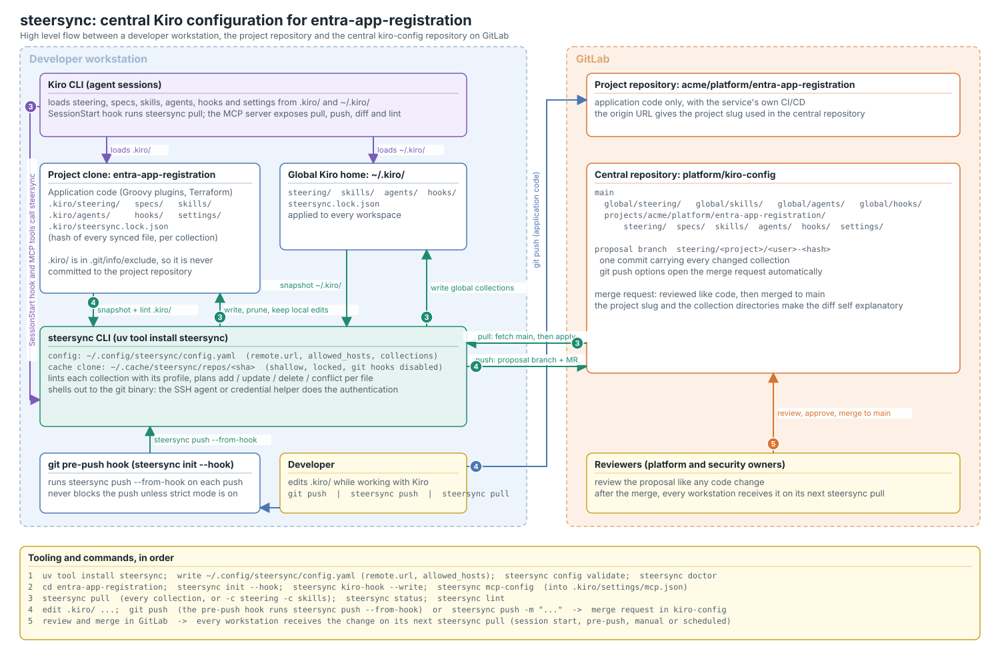

# RFC 0001: Central Kiro configuration for project repositories

| Field | Value |
|---|---|
| Status | Proposed |
| Author | Dejan Gregor |
| Date | 2026-10-12 |
| Applies to | Every project that uses Kiro, starting with `entra-app-registration` |
| Tooling | steersync 0.2, Kiro CLI V3, GitLab |

## Summary

Kiro reads its configuration from `.kiro/` in the workspace and from `~/.kiro/` on the
machine: steering documents, specs, skills, custom agents, hooks and settings. Today that
configuration lives on individual workstations, drifts between developers and is reviewed by
nobody. This RFC proposes one central GitLab repository, `platform/kiro-config`, as the
source of truth for all of it, and steersync as the tool that moves the content in both
directions with a review step in the middle.

Every change to Kiro configuration becomes a merge request in the central repository. Every
workstation receives the merged result on its next pull. The project repository itself never
carries `.kiro/`.



The diagram is also available as [PNG](../diagrams/kiro-config-sync.png) and as an editable
[draw.io file](../diagrams/kiro-config-sync.drawio). The draw.io file is the editable source;
the SVG and PNG are exports of it.

## Motivation

The `entra-app-registration` repository is a Unity Deploy resource written in Groovy with
Terraform modules. Its `.kiro/` directory grew to a dozen steering documents, several
implementation plans, a Venafi runbook, a custom agent, a Stop hook and a language server
configuration. Four problems followed:

1. **Drift.** Each developer carried a slightly different copy. A fix to a steering rule on
   one machine never reached the others, and the agent behaved differently per person.
2. **No review.** Steering changes the behaviour of an AI agent that edits production
   infrastructure code, yet nobody looked at those changes before they took effect.
3. **Sprawl.** Numeric prefixes collided (`08-*`, `11-*`), plans lived next to current rules,
   and a global rule had to be copied into every project by hand.
4. **Fragile tooling.** Kiro's `/code init` regenerates `lsp.json` and drops custom entries,
   so the Groovy language server configuration had to be re-added repeatedly.

Kiro CLI has no command to import configuration from a remote; its guidance is to copy files
from a central repository by hand. We need that copy to be automated, reviewed and safe.

## Goals

- One reviewed source of truth for every kind of Kiro content, per project and globally.
- Zero manual copying: pulling happens at session start and before each push.
- Local experimentation stays possible: a locally edited file is never silently overwritten.
- Nothing secret or machine specific ever leaves a workstation.
- Adding a new kind of content (for example knowledge base manifests) is configuration only.

## Non goals

- Replacing GitLab review with an automated approval. Reviewers stay human.
- Syncing application code or anything outside `.kiro/` and `~/.kiro/` by default.
- Supporting the Kiro IDE's symlink conventions; files are real copies.

## Design

### Roles

| Component | Where | Role |
|---|---|---|
| Project repository (`acme/platform/entra-app-registration`) | GitLab | Application code only. Its origin URL gives the project slug. `.kiro/` is excluded through `.git/info/exclude` so it is never committed here. |
| Central repository (`platform/kiro-config`) | GitLab | Source of truth. `global/<collection>/` applies to every machine; `projects/<slug>/<collection>/` applies to one project. Protected `main`, merge requests, CODEOWNERS for platform and security owners. |
| steersync CLI | Workstation | Pulls, pushes, lints and reports. Shells out to the `git` binary, so the developer's SSH agent or credential helper does the authentication. Keeps a shallow cache clone and a lock file of what it wrote. |
| git pre-push hook | Workstation | Runs `steersync push --from-hook` on every push of the project. Never blocks the push unless strict mode is on. |
| Kiro CLI | Workstation | Consumer. Reads `.kiro/` and `~/.kiro/`. A `SessionStart` hook runs `steersync pull` and the steersync MCP server exposes pull, push, diff and lint as tools. |

### Collections

steersync describes each kind of content as a collection. The defaults match the Kiro
layout; a project overrides or adds collections in `.kiro/steersync.yaml` or the user does
in `~/.config/steersync/config.yaml`.

| Collection | Workspace | Global | Central directory | Lint profile |
|---|---|---|---|---|
| `steering` | `.kiro/steering` | `~/.kiro/steering` | `steering/` | Kiro front matter, references, secrets, markdown |
| `specs` | `.kiro/specs` | none | `specs/` | markdown and secrets |
| `skills` | `.kiro/skills` | `~/.kiro/skills` | `skills/` | `SKILL.md` metadata, execute bits kept on scripts |
| `agents` | `.kiro/agents` | `~/.kiro/agents` | `agents/` | JSON shape, deprecated keys |
| `hooks` | `.kiro/hooks` | `~/.kiro/hooks` | `hooks/` | JSON shape and V3 trigger names |
| `settings` | `.kiro/settings` | none | `settings/` | `lsp.json` and `mcp.json` only |

For `entra-app-registration` the central tree therefore looks like this:

```text
projects/acme/platform/entra-app-registration/
├── steering/        product.md, tech.md, structure.md, dev-code-intelligence.md,
│                    entra-*.md, lang-*.md, unity-*.md, testing-*.md
├── specs/           tls-cert-staged-rotation/, mfa-all-time-stamping/, ...
├── skills/          venafi-tpp-websdk/SKILL.md, scripts/, references/
├── agents/          entra-app-registration.json, prompts/entra-app-registration.md
├── hooks/           tests-on-stop.json, terraform-fmt-on-save.json
└── settings/        lsp.json (Groovy language server entry), mcp.json
```

### Flow

The diagram shows the loop; these are its steps.

1. **Install and configure, once per machine.** `uv tool install steersync`, then write
   `~/.config/steersync/config.yaml` with `remote.url` and `remote.allowed_hosts`, and run
   `steersync config validate` and `steersync doctor`.
2. **Prepare the project, once per clone.** `steersync init --hook` adds every collection
   directory and the lock file to `.git/info/exclude` and installs the chaining pre-push
   hook. `steersync kiro-hook --write` creates the `SessionStart` hook and
   `steersync mcp-config` renders the MCP server entry for `.kiro/settings/mcp.json`.
3. **Pull.** `steersync pull` refreshes the cache clone from `main`, reads
   `global/<collection>/` and `projects/<slug>/<collection>/`, lints them, and writes each
   file into `~/.kiro/` or `.kiro/`. A file whose local content differs from both the lock
   file and the central copy was edited locally; it is kept and reported, and `--force`
   overwrites it. Files removed centrally are pruned. The Kiro `SessionStart` hook runs the
   same command with `--best-effort`, so a network failure never blocks a session.
4. **Push.** The developer edits `.kiro/` while working with Kiro. On the next `git push` of
   the project, the pre-push hook runs `steersync push --from-hook`; `steersync push` does
   the same on demand. steersync snapshots every collection, lints each with its profile,
   compares with `main`, and if anything differs it commits all changed collections to one
   branch named `steering/<project>/<user>-<hash>` and pushes it with GitLab push options,
   which open the merge request automatically. Identical content from two people yields the
   same branch, so duplicates are reported as already proposed.
5. **Review and merge.** Platform and security owners review the merge request like any code
   change: the project slug and the collection directories make the diff self explanatory.
   After the merge every workstation receives the change on its next pull.

### What makes it safe

- Remote URLs are validated and optionally restricted to an allow list; helper transports
  are refused. No credential is stored or handled by steersync.
- Symlinks in central content are never followed, and every write is contained inside the
  target directory. Git hooks never run in the cache clone.
- Every push is linted first: Kiro front matter, `SKILL.md` metadata, hook and agent JSON,
  secret patterns (cloud keys, private keys, GitLab, GitHub and Slack tokens). A finding with
  severity error stops the push; `--no-lint` is an explicit override.
- Size limits bound what is read from the central repository and what is proposed to it.
- The pre-push hook is best effort by design: a slow or failing central repository never
  stops a developer from pushing code.
- Machine specific files stay local. `settings` only syncs `lsp.json` and `mcp.json`, so a
  generated class path export never leaves the workstation, and a project can narrow this
  further.

### Review conventions in the central repository

- `main` is protected. Merge requests need one approval from the platform owners, and one
  from the security owners when `agents/` or `hooks/` change, because those grant tool
  permissions and run commands.
- CODEOWNERS maps `global/**` to the platform team and `projects/<slug>/**` to the owning
  team plus the platform team.
- The merge request title is generated (`steering: update <project> from <user>`) and the
  commit body lists every added, updated and deleted path.

## Tooling and commands

| Step | Command | Where it runs |
|---|---|---|
| Install | `uv tool install steersync` | once per machine |
| Configure | `~/.config/steersync/config.yaml`, `steersync config validate`, `steersync doctor` | once per machine |
| Prepare a clone | `steersync init --hook`, `steersync kiro-hook --write`, `steersync mcp-config` | once per clone |
| Receive | `steersync pull [-c NAME]` | Kiro session start, pre-push, manual, scheduled |
| Inspect | `steersync status`, `steersync lint`, `steersync config collections` | any time |
| Propose | `git push` (hook) or `steersync push [-c NAME] [-m MSG]` | after editing `.kiro/` |
| Propose global content | `steersync push --scope global` | from `~/.kiro/` |
| Review | GitLab merge request on `platform/kiro-config` | reviewers |

## Rollout for entra-app-registration

1. Create `platform/kiro-config` in GitLab with protected `main`, CODEOWNERS and the merge
   request approval rules above.
2. Reorganise the project's `.kiro/` as agreed in the steering review: domain prefixed
   steering files, plans under `specs/`, the Venafi runbook as a skill, the Groovy language
   server entry in `settings/lsp.json`, hooks as standalone V3 files.
3. From one workstation run `steersync init --hook` and `steersync push` to open the first
   merge request, then review and merge it.
4. Every other developer installs steersync, runs `steersync init --hook` and
   `steersync pull`, and removes any committed `.kiro/` from the project repository.
5. Add `steersync lint` to the project's pre-commit configuration so broken front matter or a
   leaked token is caught before it reaches the hook.
6. After two weeks, review the merge request history and decide whether global steering
   should carry more of the shared rules.

## Alternatives considered

| Alternative | Why not |
|---|---|
| Commit `.kiro/` in each project repository | Global rules still need copying, the project's reviewers rarely own agent behaviour, and secrets or machine specific settings end up in the application repository. |
| Git submodule or subtree of a central repository | Kiro does not follow symlinks and submodules are a well known source of friction; a subtree still mixes configuration commits into the application history. |
| Symlink `.kiro/` to a central checkout | The Kiro IDE does not follow directory symlinks under `~/.kiro`, and a shared checkout removes the ability to keep a local edit. |
| Kiro knowledge base pointing at a documentation repository | Knowledge bases are searchable context, not steering, hooks or agents; they do not change agent behaviour or tool permissions. |
| A one way distribution script with no review | Removes drift but not the review gap; the push path with merge requests is what makes the content trustworthy. |

## Risks and mitigations

| Risk | Mitigation |
|---|---|
| Kiro changes where it reads configuration or its inclusion modes (V3 is still an early release) | Collections are configuration; a new directory is a YAML block, not a release. |
| A pull overwrites a developer's local experiment | The lock file detects local edits and keeps them; `--force` is explicit. |
| A hook or agent change grants a dangerous permission | Lint flags deprecated permission keys; security owners approve changes under `agents/` and `hooks/`. |
| The central repository is unreachable | Pull is best effort at session start and the pre-push hook never blocks the push. |
| Two developers propose conflicting changes | Both become merge requests; GitLab shows the conflict and reviewers decide. |

## Open questions

1. Should `global/` carry organisation wide steering only, or also shared skills such as a
   release checklist? The proposal starts with steering and the `steersync.json` hook.
2. Do we want a scheduled pull (for example a daily `steersync pull --best-effort` from a
   user timer) in addition to session start and pre-push?
3. Which team owns `settings/lsp.json`, given that Kiro's `/code init` can overwrite it?

## Decision

Pending review by the platform and security owners.
